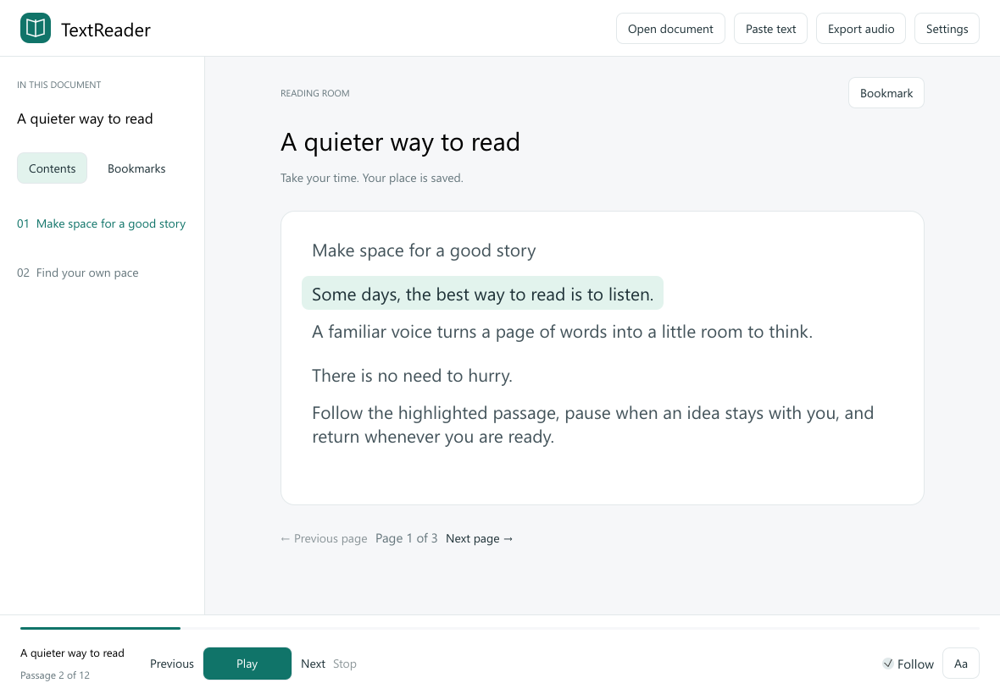
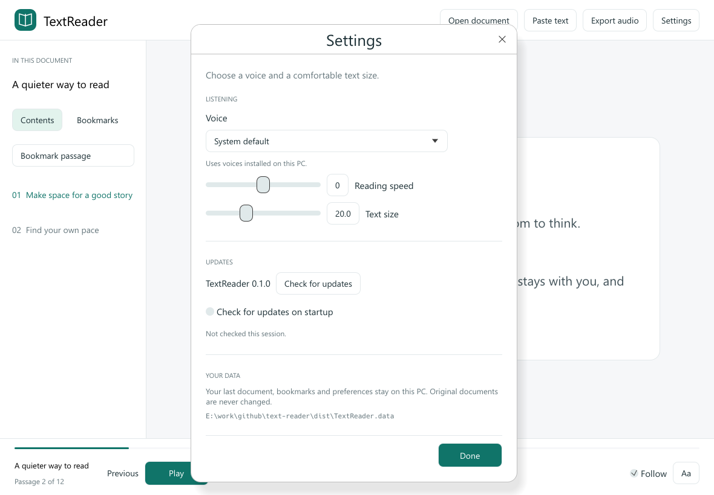

# TextReader

A quiet, local-first document listener for Windows. Read along with installed voices, keep your place and bookmarks, and export speech as WAV. Version 0.1.0 is an independent MIT-licensed implementation with original code and interface.



Real application-generated client-area capture, synthetic document, CPU/software renderer, 1180 × 820 logical pixels at 100% scale. It uses the same components and rasterizer as the desktop app.

## Read and listen

1. Choose **Open document** or **Paste text**. TXT, Markdown, DOCX and unencrypted EPUB are supported.
2. Press **Play**. The same button becomes **Pause** or **Resume**; Space also toggles playback when a text field is not focused. The current sentence or bounded passage is highlighted after submission to SAPI and advances on actual engine completion.
3. Click a passage, chapter or bookmark to choose a starting point. **Previous** and **Next** move between paragraphs; page controls browse groups of five passages. Navigation stops playback. Press Play to start at the selected passage again.
4. Use **Bookmark passage** in the left navigation panel to save the highlighted passage and open **Bookmarks**. A saved passage shows **Passage saved**. The Bookmarks tab also lets you enter an optional name before saving or remove a bookmark. Up to 200 bookmarks per document are supported. The last document and reading position restore without automatically playing sound.
5. Open **Settings** for voice, reading speed and text size. The system voice works by default; classic desktop SAPI voices are enumerated. Windows Narrator/OneCore-only voices may not appear. Voice/speed changes stop playback so the next Play uses the new choice.
6. **Export audio** creates a new `.wav` containing the entire document with the selected voice and speed. Progress and cancellation are provided. Existing destination files are preserved.

Full text wraps on a paper surface instead of being truncated into preview rows. Disable **Follow** to browse another page while listening. Highlighting is passage-level, not word alignment. Long sentences are divided into at most 300 Unicode scalar values per passage.

## Settings



Real application-generated Settings capture using an isolated fixture. The captured profile has startup update checks disabled; new normal profiles enable them by default. No account, cloud voice or model download is needed.

Close Settings with **Done**, the title-bar **×**, or **Esc**. Preferences apply immediately and are kept when the panel closes. If the voice list is expanded, Esc closes the list first. **Paste text** also supports ×, **Cancel** and Esc, preserving your draft for the current session.

## Formats and limits

| Format | Support |
| --- | --- |
| TXT / MD | UTF-8, UTF-8 BOM and UTF-16 LE/BE with BOM. Blank-line paragraphs and `#` / `##` chapter headings. Legacy code pages are rejected with an explanation. |
| DOCX | Main document text and paragraphs; no layout, images, headers, footnotes or embedded objects. Legacy `.doc` is unsupported. |
| EPUB | Unencrypted EPUB package manifest/spine order and XHTML body text. Scripts/styles are ignored. Layout, images and navigation-tree metadata are omitted. Encryption manifests, percent-encoded or fragment-bearing spine paths are rejected. |
| PDF / OCR | Not included. Export/copy text to TXT or paste it. Scanned PDFs require external OCR. |
| Audio | PCM WAV, mono, 22.05 kHz, 16 bit. Native Zira tests verified non-silent samples, speed changes, progress, cancellation and destination preservation. MP3 is unsupported. |

Limits: 32 MiB input, 8 MiB per XML archive part, 4 MiB extracted text; EPUB additionally permits up to 5,000 archive entries, 1,000 spine chapters and 32 MiB expanded chapter markup. Archive parts are read in memory, never unpacked to disk. External entities/resources are not fetched. DRM, malformed XML/ZIP and unsupported formats produce errors.

## Local data and updates

Data stays unencrypted on this PC in `%LOCALAPPDATA%\TextReader\session.json`: the last extracted document, content-based reading positions, bookmarks and preferences. Creating a `TextReader.data` directory beside the EXE selects portable storage there instead. Original documents are never changed. Session writes use atomic Windows replacement and a previous-session backup. Corrupt sessions are preserved; save failures offer retry or closing without saving. Close the app before backing up/removing its profile. Multiple simultaneous instances are not coordinated.

**Settings → Updates** shows the installed version, **Check for updates**, and the persistent **Check for updates on startup** toggle, enabled by default. Disabled profiles make no startup request. Checks run in the background; successful no-update results and transient startup failures are unobtrusive. Document content is never uploaded.

The planned canonical repository is [siarheisinelnikau/text-reader](https://github.com/siarheisinelnikau/text-reader); this task did not publish it or a release. Missing/unpublished releases and network/rate-limit failures are errors, not an up-to-date result. A newer stable release must supply the compatible `TextReader-vVERSION.exe` and `SHA256SUMS.txt`. **Download and install** is user initiated, verifies size/SHA-256, saves the session, waits for exit, replaces the executable with a rollback copy and restarts. A writable portable folder is required; there is no elevation. Installation failure is recorded for the next launch. The live updater round-trip remains unverified. The existing executable filename is retained after an update.

## Rendering and verification

The desktop uses a CPU rasterizer, retained bitmap and Windows GDI presentation, with no OpenGL/DirectX renderer. The event loop waits when idle. A bounded isolated test verified zero layout/raster/present operations during five-second visible, minimized and restored idle samples; this does not establish every interactive timing or disable Windows desktop composition. See [validation details](docs/INTERACTIVE-VALIDATION.md), [architecture](docs/ARCHITECTURE.md) and [remaining manual checks](docs/MANUAL-TESTS.md).

The intended platform is Windows 10/11 x64 with a classic SAPI voice. Rust 1.95 or newer, the MSVC toolchain and Windows SDK are required to build; no WebView, external extractor, speech script, model or paid API is required to run. Clean-machine compatibility and the minimum Windows version still need validation.

```powershell
cargo fmt --all -- --check
cargo clippy --locked --all-targets -j 2 -- -D warnings
cargo test --locked --all-targets -j 2
.\scripts\package.ps1
.\scripts\verify-artifact.ps1
```

Cargo uses at most two jobs and local `target/`. Packaging generates `dist/TextReader-v0.1.0.exe` and `SHA256SUMS.txt`, statically linking the application's MSVC CRT. Windows system DLLs remain runtime requirements. Ordinary tests use synthetic fixtures and a silent adapter; they do not initialize SAPI, play audio, open windows or contact the network. CI builds and checks artifacts without publishing.

The original book icon is embedded in the EXE for Explorer/shortcuts and assigned explicitly to the native window and taskbar. The Windows SDK resource compiler embeds the committed multi-resolution ICO during Cargo builds; no separate icon file is needed beside the release EXE. `scripts/verify-artifact.ps1` checks the actual icon resources and sizes in the built PE file. Editable assets are in `assets/`; `scripts/generate-icon.py` needs Pillow only when regenerating them.

Static review without Computer Use: `scripts/capture.ps1 -Output ABSOLUTE.png -Screen reader|bookmarks|settings|empty`. It launches the real EXE in an isolated, bounded offscreen render-save-exit mode; no workers, user profile, audio or update requests are started. Width/height are logical pixels and `-Scale` controls physical output. Screenshots verify the client UI, not native chrome, dialogs or input traversal.

Opt-in backend check: `cargo run --locked --example sapi_smoke -j 2` renders synthetic speech into `.test-output/`. Add `-- --playback` only when sound is authorized to test real SAPI transport as well. `scripts/diagnose.ps1 -Output ABSOLUTE.json` runs a bounded isolated visible/minimized/restored scheduling test and exits; it is separate from static capture.

## License and provenance

[MIT](LICENSE). Dependencies retain their licenses. [NaturalReader software](https://www.naturalreaders.com/software.html) informed the document-listening use case only; no competitor code or assets are included. See the [initial release draft](docs/RELEASE-NOTES-v0.1.0.md) and [original code-only verification](docs/VERIFICATION.md) for historical context.

## Shared updater source

Keep the local `rust-auto-updator` workspace beside this repository. Cargo uses `../rust-auto-updator/crates/rust-auto-updator`; the companion is currently unpublished, so standalone clone/CI builds need that source provisioned first. `src/updater.rs` now contains product configuration and adapters only. The companion core owns release selection, download integrity, x64 PE validation, native replacement, rollback and staging cleanup. The existing `TextReader-vVERSION.exe` plus `SHA256SUMS.txt` contract, saved startup opt-out and save-before-restart workflow are preserved. Earlier installed versions use their own existing helper and can replace/relaunch this EXE without flags. Future releases use the shared helper protocol.

Icon proof without application launch: `python scripts/verify-icon-pixels.py dist/TextReader-v0.1.0.exe assets/text-reader.ico .test-output/icons.png` uses Pillow and resource-only loading plus native DrawIconEx memory bitmaps. It checks nonblank native-size resources on light/dark backgrounds. TextReader intentionally has no tray. Title-bar/taskbar icons now load the embedded 16/32px families at the current DPI and refresh when monitor scaling changes.

Current migration evidence: [shared updater, icon and rendering audit](docs/UPDATER-AUDIT-2026-11-01.md).
