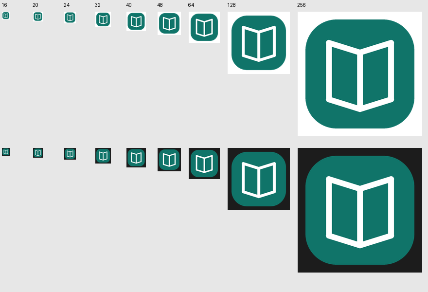

# Shared updater, icons and rendering audit — 2026-11-01

The product keeps its existing Reader/Settings workflows and CPU/GDI host. Reusable release discovery, download integrity, same-volume staging, native replacement, rollback and cleanup moved to the sibling `rust-auto-updator` core. The adapter retains the canonical product identity, SHA256SUMS release contract, startup preference and save-before-restart flow. Prepared downloads have one owner across the UI/network worker, so abandoned updates are cleaned without affecting session data. Portable helper-error logs use the core-validated installation target.

The title bar and taskbar load native resource frames at 16/32 logical pixels for the current DPI and reload on scale changes. The actual packaged EXE contains matching 16, 20, 24, 32, 40, 48, 64, 128 and 256px icon frames. Resource-only LoadImageW/DrawIconEx proof on light/dark backgrounds was inspected; the 16px icon has 14px visible artwork. TextReader has no tray by design.

## Checks

- `cargo fmt --all --check` and `cargo clippy --offline --locked --all-targets -j 1 -- -D warnings` passed. Cargo reported environment hard-link cache warnings, with no source lint failures.
- `cargo test --offline --locked --all-targets -j 1`: 19 tests passed, including stable release identity/checksum selection and settings repaint settling.
- Optimized x64 build with `-C target-feature=+crt-static` passed. `scripts/verify-artifact.ps1` verified the PE, embedded icons, static CRT boundary, absent GPU renderer imports and package SHA-256.
- No computer use, desktop input automation, audio, real documents, update download/installation or publication was performed.

## Bounded runtime evidence

An isolated diagnostic used synthetic populated content, no workers/network/audio, and exited on its own. Backend: egui software rasterizer → retained BGRA bitmap → softbuffer Win32 GDI. The diagnostic inspected its own WM_GETICON handles: 16×16 title-bar and 32×32 taskbar at 100% scaling.

| State | Seconds | CPU, % of one core | Layout | Raster | Present |
| --- | ---: | ---: | ---: | ---: | ---: |
| visible_idle | 5.003 | 0.000 | 0 | 0 | 0 |
| minimized_idle | 5.003 | 0.000 | 0 | 0 | 0 |
| restored_idle | 5.000 | 0.000 | 0 | 0 | 0 |

Executable SHA-256: `13c8a7ff3357ee228e8fedc0039bc4b1a7b16ced84b562675d827e2b519081c0`. The 0% CPU values are at Windows process-timer resolution. [Raw report](validation/shared-updater-gate-2026-11-01.json). Loaded-module evidence contains no OpenGL, Direct3D or Vulkan renderer module; GPU/compositor latency was not profiled.

## Remaining limits

Actual pointer/keyboard responsiveness, Explorer icon caching, mixed-DPI monitor transitions and a live update/rollback round-trip remain unverified in this task. The existing earlier helper installs this binary and relaunches without arguments; future releases use the shared helper protocol. Companion source must be provisioned beside this repository for standalone/CI builds because the shared workspace is not published yet. No remote checkout source was invented.
